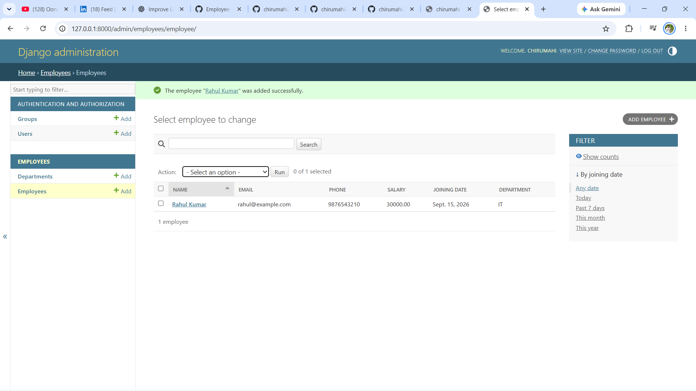

# Employee Management System

A web-based Employee Management System developed using Python and Django. This project helps manage employee and department information through a simple interface.

## Features

- Add, view, edit, and delete employee records
- Search employees by name, email, or phone
- Filter employees by department
- Manage employees and departments using Django Admin
- Form validation and success messages
- SQLite database integration
- Responsive HTML and CSS interface

## Technologies Used

- Python
- Django
- Django ORM
- SQLite
- HTML
- CSS
- Bootstrap (if used in your project)

## Project Structure

- `employee_project/` – Main Django project
- `employees/` – Employee management application
- `manage.py` – Django management utility
- `requirements.txt` – Project dependencies

## Installation and Setup

1. Clone the repository:

   ```bash
   git clone https://github.com/chirumahi27/Employee-Management-System.git

   ## Screenshots

### Employee Management Dashboard


### Employee Details

